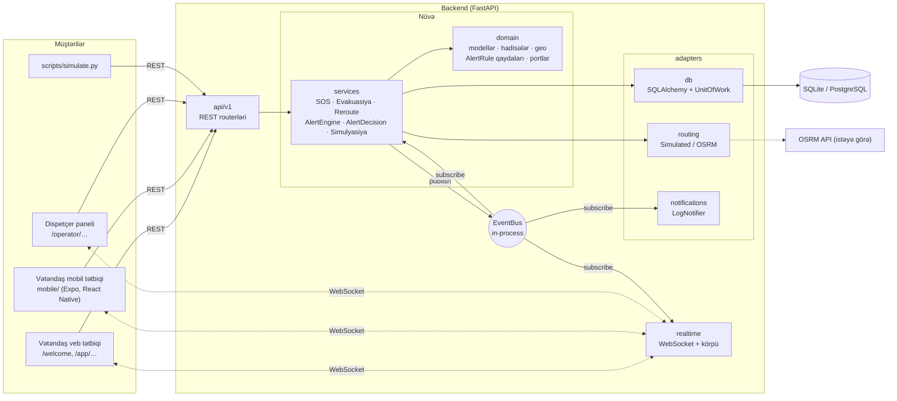
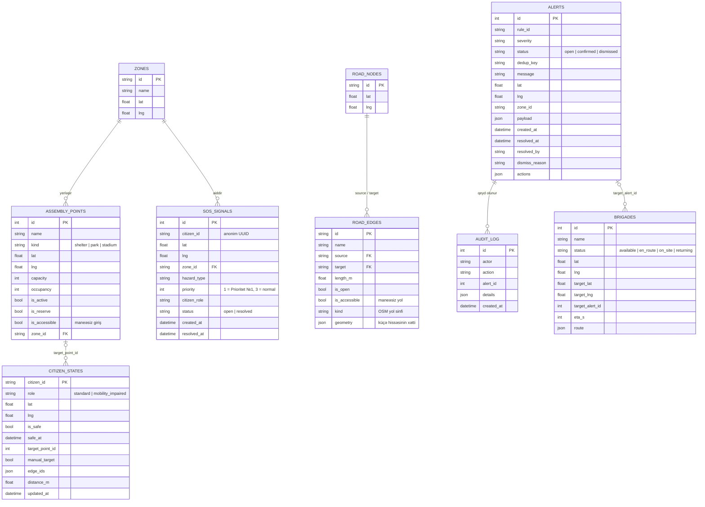
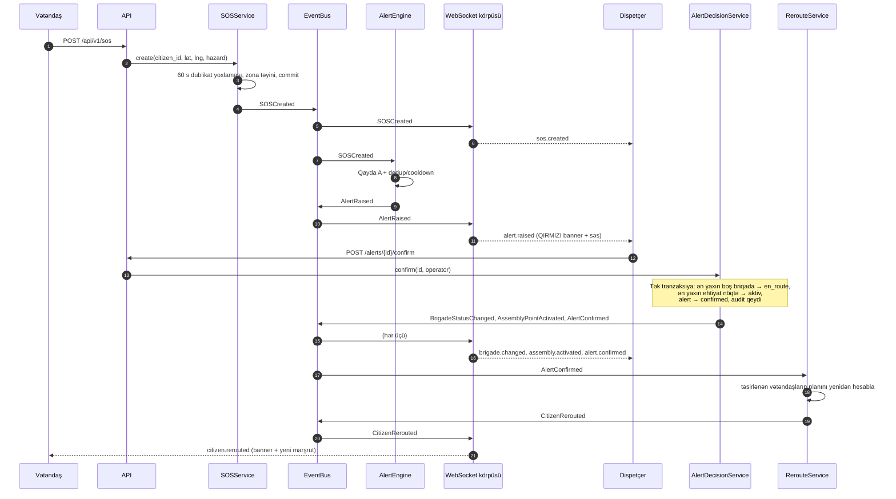
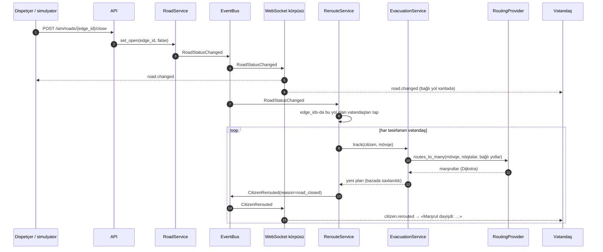
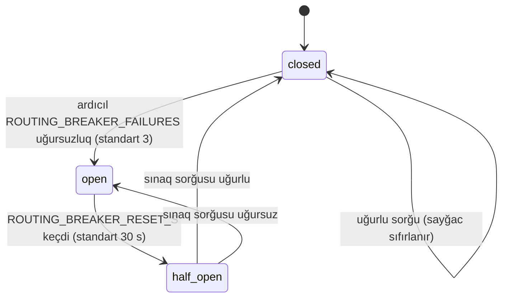
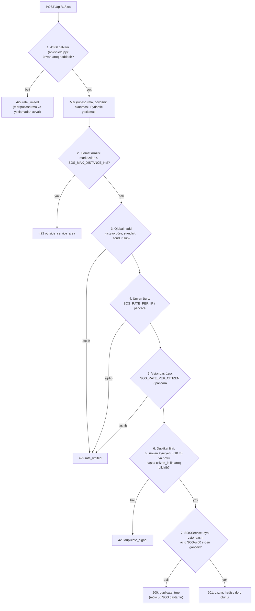

# Texniki izahat

Şəhər Böhranı və Kütləvi Evakuasiya Mühərriki: arxitektura, məlumat modeli, alqoritmlər və genişləndirmə bələdçisi.

## 1. Arxitektura

Sistem hexagonal (portlar və adapterlər) prinsipi ilə qurulub. Asılılıqlar yalnız içəriyə doğru yönəlir: `domain` heç nəyi import etmir, `services` portlar üzərindən işləyir, adapterlər yalnız `container.py`-də seçilir.



Əsas qərarlar:

- **Hadisə şini modullar arasında yeganə bağlantıdır.** Servis vəziyyəti dəyişir, tranzaksiyanı bağlayır, sonra hadisə dərc edir. Həyəcan mühərriki, yenidən yönləndirmə servisi, WebSocket körpüsü və bildiriş kanalı bir-birindən xəbərsiz abunəçilərdir.
- **Yenidən yönləndirmə server tərəfdə hesablanır.** Vətəndaşın cari marşrutu (`citizen_states`) bazada saxlanılır; brauzer yalnız hazır planı çəkir. Bu, məntiqi testlə örtməyə və gələcəkdə mobil/SMS müştəri əlavə etməyə imkan verir.
- **Asinxron endpoint + sinxron SQLAlchemy.** Bütün yazılar tək hadisə dövrəsində icra olunur; tranzaksiya daxilində `await` yoxdur, ona görə əməliyyatlar bir-birinə qarışmır. Qiyməti: uzun DB sorğusu dövrəni bloklayır (bax: məhdudiyyətlər).

## 2. Modullar və qatlar

| Qat | Qovluq | Məzmun |
|---|---|---|
| Domain | `app/domain/` | `models.py` (dataclass-lar), `events.py`, `geo.py` (haversine, mərkəz, polyline), `hazards.py` (təhlükə registri), `evacuation.py` (sıralama və tövsiyə seçimi), `ports.py` (EventBus, RoutingProvider, Clock, Notifier), `alerts/` (AlertRule, registr, qaydalar) |
| Services | `app/services/` | `sos.py`, `evacuation.py`, `reroute.py`, `alert_engine.py`, `alert_decision.py`, `infrastructure.py` (yollar, nöqtələr, briqadalar), `simulation.py`, `scenarios.py`, `dashboard.py`, `auth.py` (JWT və icazə cədvəli), `rate_limit.py` (sürüşən pəncərə), `sos_guard.py` (SOS müdafiəsi), `roads_cache.py` (hazır yol şəbəkəsi) |
| Adapters | `app/adapters/` | `db/` (ORM sətirləri, repozitoriyalar, UnitOfWork, seed), `routing/` (simulated, osrm, resilient: circuit breaker və ehtiyat zənciri, factory), `eventbus/inprocess.py`, `notifications/channels.py` |
| API | `app/api/` | `v1/public.py`, `v1/operator.py`, `v1/sim.py`, `schemas.py` (Pydantic v2), `errors.py`, `deps.py` (auth və icazə asılılıqları), `shield.py` (SOS üçün xam ASGI qatı) |
| Realtime | `app/realtime/` | `manager.py` (bağlantılar), `bridge.py` (hadisə → WS), `router.py` |
| Kompozisiya | `app/container.py`, `factory.py`, `config.py` | Adapter seçimi, abunəliklər, FastAPI tətbiqi, parametrlər |

Praqmatik sadələşdirmə: servislər repozitoriyalar üçün ayrıca Protocol yox, birbaşa `UnitOfWork` sinfindən istifadə edir. Repozitoriyalar yalnız domain dataclass-larını qaytarır, ona görə servislər ORM-ə toxunmur.

Frontend (`frontend/src/`): bir dizayn sistemini bölüşən iki məhsul. `citizen/` və `operator/` bir-birindən asılı deyil.

| Qovluq | Məzmun |
|---|---|
| `design/` | `tokens.ts`: rəng, şrift, məsafə, radius, kölgə, hərəkət və ölçülərin tipli tək mənbəyi. `cssVars.ts` onları CSS dəyişənlərinə çevirir; Vite plaqini nəticəni `index.html`-ə yerləşdirir. Tokenlərdən kənarda hex rəng və piksel ölçüsü yoxdur |
| `platform/` | Yaddaş, geolokasiya, vibrasiya, səs və WebSocket ünvanı üçün kiçik interfeyslər. `localStorage`, `navigator` və `AudioContext`-ə yalnız `web.ts` toxunur |
| `ui/` | Ortaq komponentlər (düymə, siyahı sətri, vərəq, tab paneli, yan panel, banner, toast, ölçü zolağı, nişan, açar…) və SVG nişan dəsti |
| `map/` | `scene.ts`: xəritədə nə çəkiləcəyinin məlumat modeli (`MapScene`). `MapView.tsx`: onu Leaflet ilə çəkən render. Nəyin çəkiləcəyi qərarı Leaflet kodunda deyil, `citizen/scene.ts` və `operator/scene.ts`-dədir |
| `shell/` | Başlanğıc ekranı, ekran başlığı, dil seçimi, bağlantı göstəricisi, «tapılmadı» ekranı |
| `citizen/` | `session.tsx`: vətəndaş sessiyası (rol, mövqe, plan, açıq SOS, «təhlükəsiz» bayrağı, canlı bağlantı) ekranlardan yuxarıda saxlanılır, ona görə tablar arasında keçid vəziyyəti itirmir. `screens/`: tanışlıq, xəritə, nöqtələr, SOS, ayarlar |
| `operator/` | `session.tsx`: giriş, `state.ts`-dəki reducer-i əhatə edən panel vəziyyəti, keçmiş həyəcanlar, saxlanılan hadisə lenti və bütün əməliyyatlar. `screens/`: giriş, canlı xəritə, həyəcanlar, SOS növbəsi, resurslar, audit, simulyasiya |
| `api/`, `lib/`, `i18n/` | Tipli klient, formatlama, həndəsə, WebSocket hook, iki dil faylı |

Tam təsvir (hər token, hər komponent, adapterlər, React Native üçün bələdçi): [DESIGN.md](DESIGN.md).

Mobil tətbiq (`mobile/src/`, Expo SDK 58, React Native, Expo Router): vətəndaş tətbiqi və onun içində dispetçer paneli (giriş, canlı xəritə, həyəcanlar, SOS növbəsi, resurslar; simulyasiya və audit yalnız vebdədir). Eyni REST və WebSocket müqaviləsindən istifadə edir; backend-də mobil üçün ayrıca kod yoxdur.

| Hissə | Vebdən necə gəlir |
|---|---|
| `design/tokens.ts`, `api/types.ts`, `i18n/*.json`, `lib/*`, `map/scene.ts`, `citizen/banner.ts`, `citizen/scene.ts`, `citizen/labels.ts`, `citizen/useLocate.ts`, `platform/types.ts` | Dəyişmədən **surət**. Ortaq paket yoxdur: fayl dəyişəndə hər iki yerdə yenilənməlidir |
| `api/client.ts`, `i18n/index.ts`, `citizen/session.tsx` | Kiçik dəyişikliklə surət: server ünvanı `config.ts`-dən (`EXPO_PUBLIC_API_URL`), `reloadLocale()`, dil dəyişəndə ekranların yenilənməsi |
| `platform/native.ts` | Yenidən yazılıb: `AsyncStorage`, `expo-location`, `expo-haptics`, `expo-crypto`. Yaddaş interfeysi sinxrondur, `AsyncStorage` isə yox; ona görə dəyərlər açılışda bir dəfə yaddaşa oxunur (`hydrateStorage`), sonra oradan verilir və diskə arxa planda yazılır |
| `design/theme.ts`, `ui/`, `shell/` | Yenidən yazılıb: eyni adlar və props ilə React Native komponentləri, nişanlar `react-native-svg` ilə |
| `map/MapView.tsx` | Yenidən yazılıb: eyni `MapScene`-i `react-native-maps` ilə çəkir (iOS-da Apple Maps). Maneəli küçələr yalnız vətəndaşın 2,5 km ətrafında çəkilir |
| `app/`, `citizen/screens/` | Expo Router marşrutları və ekranların React Native versiyası; aşağıda üç tab və daimi SOS düyməsi |

Yoxlanılıb: tip yoxlaması, Metro ilə iOS paketinin yığılması, iOS simulyatorunda Expo Go ilə açılış. Yoxlanılmayıb: Android, real cihaz, mağaza yığımı. Ətraflı: [mobile/README.md](../mobile/README.md).

### Frontend marşrutları

| Ünvan | Ekran |
|---|---|
| `/` | İlk dəfə gələni `/welcome`-ə, qalanlarını `/app/map`-ə göndərir |
| `/welcome` | Tanışlıq: dil → mövqe → xüsusi qayğı rolu; xəritədə çəkilmiş marşrutla bitir |
| `/app/map` | Tam ekran xəritə və cari marşrut vərəqi |
| `/app/points`, `/app/points/:id` | Toplanış nöqtələrinin siyahısı və təfərrüatı |
| `/app/sos` | SOS (iki toxunuş + 5 saniyəlik «Ləğv et»), statusu, «Təhlükəsizəm» |
| `/app/settings` | Rol, dil, məxfilik qeydi, dispetçer girişinə keçid |
| `/operator/login` | Dispetçer girişi |
| `/operator/live` | Canlı xəritə, vəziyyət zolağı, seçilmiş obyektin paneli və hadisə lenti |
| `/operator/alerts`, `/operator/alerts/:id` | Açıq və keçmiş həyəcanlar, təsdiq və rədd |
| `/operator/sos` | SOS növbəsi (Prioritet №1 başda) və rayonlar üzrə SOS |
| `/operator/resources` | Toplanış nöqtələri və briqadalar |
| `/operator/audit` | Audit jurnalı |
| `/operator/simulation` | Simulyasiya alətləri; yalnız `/api/v1/meta` cavabında `sim_enabled: true` olduqda |
| `/citizen`, `/operator` | Köhnə ünvanlar: `/app/map` və `/operator/live`-ə yönləndirir |

Naməlum ünvan «tapılmadı» ekranını göstərir. Açıq QIRMIZI həyəcan dispetçerin bütün ekranlarında yuxarıda sabit qalır. SOS-da «Ləğv et» pəncərəsi siqnal göndərilməzdən **əvvəl** işləyir, çünki serverdə göndərilmiş SOS-u geri götürən endpoint yoxdur.

## 3. Məlumat modeli



Qeydlər: zona = ən yaxın zona mərkəzi (poliqon yoxdur). Vaxtlar UTC-də saxlanılır. `citizen_states.edge_ids` vətəndaşın cari marşrutundakı yolların siyahısıdır: yol bağlananda kimin təsirləndiyi buradan tapılır.

## 4. Hadisə axınları

### 4.1 SOS → həyəcan → təsdiq



### 4.2 Yol bağlanması → yenidən yönləndirmə



Nöqtənin dolması eyni cür işləyir: `AssemblyOccupancyChanged` hadisəsində doluluq ≥ `REROUTE_OCCUPANCY_PCT` olarsa, həmin nöqtəyə gedən vətəndaşlar növbəti ən yaxşı nöqtəyə yönləndirilir.

## 5. Böhran alqoritmi

Hər qayda `AlertRule` sinfidir: `evaluate(event, context) -> list[AlertCandidate]`. Qayda yalnız «namizəd» qaytarır; saxlama, dedup və dərc `AlertEngine`-in işidir.

### 5.1 Qayda A: SOS klasteri (`rules/sos_cluster.py`)

Hər yeni SOS-da (lövbər) inkremental hesablanır, ona görə pəncərə həmişə ən yeni siqnalda bitir (sürüşən pəncərə):

1. `pəncərə = [indi − SOS_CLUSTER_WINDOW_MIN, indi]` daxilindəki **açıq** SOS-lar götürülür (sərhəd daxildir).
2. **Zona budağı:** lövbərlə eyni zonadakı siqnallarda fərqli `citizen_id` sayı ≥ `SOS_CLUSTER_MIN_COUNT` olarsa namizəd yaranır. Dedup açarı: `sos_cluster:zone:<zona>`.
3. **Radius budağı** (zona budağı işləmədikdə): lövbərdən `SOS_CLUSTER_RADIUS_M` daxilindəki hər siqnal dairə mərkəzi kimi sınanır; fərqli vətəndaş sayı ən çox olan qrup seçilir. Bu, lövbərin klasterin kənarında olduğu halı da tutur. Say həddi keçərsə və yaxınlıqda (radius daxilində) aktiv klaster həyəcanı yoxdursa, namizəd yaranır.
4. Namizəd klasterin mərkəzini (orta nöqtə), fərqli vətəndaş sayını, təhlükə növlərini və təsirlənən zonaları daşıyır.

Mürəkkəblik (n = pəncərədəki açıq SOS sayı, k = lövbərin radiusundakı siqnallar, k ≤ n):

| Addım | Vaxt | Yaddaş |
|---|---|---|
| Pəncərə sorğusu (`created_at` indeksi) | O(log N + n) | O(n) |
| Zona budağı | O(n) | O(n) |
| Radius budağı | O(k·n), ən pis halda O(n²) | O(n) |

Pəncərə 5 dəqiqə olduğu üçün n kiçik qalır. Yüksək yük üçün yol xəritəsi: PostGIS `ST_DWithin` və ya məkan şəbəkəsi (grid hashing) ilə O(n)-ə endirmək.

Qəbul edilmiş şərhlər: yalnız **açıq** SOS-lar sayılır («Təhlükəsizəm» deyən vətəndaş klasterdən çıxır); radius yoxlaması siqnal mərkəzli dairələrlə aparılır (ixtiyari mərkəzli minimal əhatə dairəsi axtarılmır).

### 5.2 Qayda B: həddən artıq dolma (`rules/overcrowding.py`)

`AssemblyOccupancyChanged` hadisəsində aktiv nöqtənin doluluğu `CRITICAL_OCCUPANCY_PCT`-dən **ciddi böyükdürsə** namizəd yaranır (95% → yox, 95,1% → var). O(1). Faiz `occupancy * 100 / capacity` kimi hesablanır ki, 950/1000 dəqiq 95,0 olsun (üzən nöqtə xətası sərhəddə yanlış həyəcan verməsin).

### 5.3 Dedup və cooldown

`AlertEngine` namizədi yalnız o halda saxlayır ki, eyni `dedup_key` ilə nə açıq həyəcan, nə də son `ALERT_COOLDOWN_MIN` dəqiqədə bağlanmış (təsdiqlənmiş və ya rədd edilmiş) həyəcan olmasın.

### 5.4 Təsdiq (`AlertDecisionService.confirm`)

Tək tranzaksiyada: (1) həyəcan kilidlənir (`SELECT … FOR UPDATE`, SQLite-da nəzərə alınmır); (2) artıq təsdiqlənibsə əvvəlki nəticə qaytarılır (idempotentlik), rədd edilibsə 409; (3) boş briqadalar arasından marşrut məsafəsi ən kiçik olan seçilir, `en_route` olur; (4) qeyri-aktiv ehtiyat nöqtələrdən marşrutla ən yaxını açılır; (5) həyəcan `confirmed`, audit qeydi yazılır; (6) commit. Hər hansı addımda xəta bütün dəyişiklikləri geri qaytarır. Hadisələr yalnız commit-dən sonra dərc olunur.

## 6. Marşrutlaşdırma

`RoutingProvider` portu: `route(origin, destination, closed_edge_ids)` və `routes_to_many(...)`. Bağlı yollar parametr kimi ötürülür, ona görə provayder vəziyyətsizdir.

- **`SimulatedRoutingProvider` (standart):** networkx üzərində Dijkstra, **real küçə şəbəkəsində**. Ad tarixi səbəbdən «simulated»dır: simulyasiya olunan yol bağlanmalarıdır, şəbəkənin özü realdır.
  - *Məlumat.* `scripts/build_road_graph.py` Bakının küçələrini OpenStreetMap-dən (Overpass API) yükləyir: `trunk`, `primary`, `secondary`, `tertiary`, `unclassified`, `residential`, `pedestrian`. Yollar kəsişmələrdə tillərə bölünür, eyni küçənin ardıcıl hissələri birləşdirilir, ən böyük əlaqəli komponent saxlanılır. Nəticə: 4 509 düyün, 7 051 til; hər til küçə hissəsinin həndəsəsini (polyline), uzunluğunu, adını və sinfini daşıyır. Fayl layihəyə daxildir, iş vaxtı internet lazım deyil. Fayl yoxdursa sintetik şəbəkəyə keçilir.
  - *Mövqenin şəbəkəyə bağlanması.* Mövqe kəsişməyə yox, yaxın küçənin **ən yaxın nöqtəsinə** proyeksiya olunur. Axtarış məkan şəbəkəsi (təxminən 340 × 445 m xanalar) ilə aparılır. Ən çoxu 6 yaxın küçə namizəd götürülür və hamısı müvəqqəti başlanğıc düyünü ilə qrafa qoşulur; hansından girməyi Dijkstra özü seçir. Bu, vətəndaşın yanındakı küçə bağlananda onun çıxışsız «cib»də qalmasının qarşısını alır.
  - *Küçədən kənar yeriş.* Mövqedən küçəyə qədər düz xətt müqayisədə 3 qat bahalı sayılır (`ACCESS_PENALTY`), əks halda alqoritm məhəllələrin üstündən «kəsə yol» seçərdi. Qaytarılan məsafə realdır. Ən yaxın istifadə oluna bilən küçə 750 m-dən uzaqdırsa (`MAX_ACCESS_M`), yer əlçatmaz sayılır.
  - *Həndəsə.* Marşrut xətti: mövqe → küçədəki nöqtə → ilk küçənin hissəsi → yol boyu küçələrin tam həndəsəsi → son küçənin hissəsi → təyinat. Bir Dijkstra çağırışı bütün toplanış nöqtələrinə xidmət edir: O((V + E) log V); plan təxminən 15 ms-də hesablanır.
  - *Bağlı və maneəli yollar.* Həm axtarışdan, həm də mövqe bağlanmasından çıxarılır.
- **`OSRMRoutingProvider` (`ROUTING_PROVIDER=osrm`):** ictimai OSRM `/route/v1` API-si. Simulyasiya edilmiş yol bağlanmalarını ötürmək mümkün deyil, ona görə bağlanma əsaslı yönləndirmə yalnız simulyasiya provayderi ilə işləyir. Xəta (HTTP 5xx, bağlantı xətası) və ya vaxt aşımı zamanı sistem dayanmır: circuit breaker ehtiyat marşrut rejiminə keçir (bax: [6.2](#62-dayanıqlılıq-circuit-breaker-və-ehtiyat-marşrut-rejimi)).

Plan seçimi (`domain/evacuation.py`): çatıla bilən aktiv nöqtələr marşrut məsafəsinə görə sıralanır; tövsiyə = doluluğu `REROUTE_OCCUPANCY_PCT`-dən aşağı olan ən yaxın nöqtə. Hamısı doludursa ən yaxını qaytarılır (`all_full=true`). Heç birinə yol yoxdursa `reachable=false` və boş siyahı (xəta yox). Çatma vaxtı = məsafə / `WALK_SPEED_MPS`.

Xəritədə küçə hissələri canvas qatı ilə çəkilir (`map/MapView.tsx`): hər til üçün React elementi yaradılmır, yalnız üslubu dəyişən tillər yenilənir. Bütün şəbəkə çəkilmir (plitələr onu onsuz da göstərir): vətəndaşda yalnız bağlı yollar və maneəsiz profildə maneəli yollar, dispetçerdə yalnız bağlı yollar və seçilmiş yol. Dispetçer yolu onun yaxınlığına toxunmaqla seçir: `lib/geo.ts`-dəki `nearestEdge` toxunulan nöqtəyə ekranda 24 piksel daxilində ən yaxın küçəni tapır, təfərrüat panelində «Yolu bağla» / «Yolu aç» düyməsi görünür. `/roads` cavabı gzip ilə sıxılır.

### 6.1 Rollar, Prioritet SOS və maneəsiz marşrut

`domain/roles.py` rolları və onların siyasətini saxlayır:

| Rol (`CitizenRole`) | SOS prioriteti | Marşrut profili |
|---|---|---|
| `standard` | 3 (normal) | adi |
| `mobility_impaired` (hərəkət məhdudiyyətli / xüsusi qayğıya ehtiyacı olan) | **1 (kritik, «Priority #1»)** | **maneəsiz** |

- **Rolun bəyanı.** Vətəndaş anonim qalır; rolu tətbiqdəki açarla özü bildirir. Rol `POST /citizens/{id}/route` və `POST /sos` sorğularında `role` sahəsi ilə göndərilir və `citizen_states.role`-da saxlanılır. Sahə buraxılarsa saxlanılmış rol işlədilir, ona görə avtomatik yenidən yönləndirmə profili itirmir.
- **Prioritet SOS.** `SOSService.create` rolun siyasətindən `priority` dəyərini götürür və SOS-la birlikdə saxlayır (`sos_signals.priority`, `citizen_role`). SOS siyahıları əvvəlcə prioritetə, sonra yeniliyə görə sıralanır; `sos.created` mesajı `priority` daşıyır və panel onu ayrıca növbədə göstərir. Qayda A-da prioritet SOS adi siqnal kimi sayılır.
- **Maneəsiz marşrut.** Hər yolun (`road_edges.is_accessible`) və hər toplanış nöqtəsinin (`assembly_points.is_accessible`) əlçatanlıq bayrağı var. Maneəsiz profildə `EvacuationService.build_plan` (1) yalnız maneəsiz girişi olan nöqtələri namizəd götürür, (2) maneəli yolların siyahısını bağlı yollarla birləşdirib marşrut provayderinə «keçilməz» kimi verir, (3) çatma vaxtını `ACCESSIBLE_SPEED_MPS` ilə hesablayır. `RoutingProvider` interfeysi dəyişmir: provayder üçün maneəli yol bağlı yoldan fərqlənmir.
- **Dayanıqlıq.** Maneəli yollar yalnız kiçik küçələr arasından və elə seçilir ki, maneəsiz şəbəkə bağlı qalsın; magistral yollar həmişə maneəsizdir. Maneəsiz yol ümumiyyətlə yoxdursa plan `reachable=false`, `accessible=true` qaytarır və tətbiq vətəndaşa yerində qalıb Prioritet SOS göndərməyi tövsiyə edir.

### 6.2 Dayanıqlılıq: circuit breaker və ehtiyat marşrut rejimi

Xarici marşrut API-si (OSRM) sıradan çıxanda, 503 qaytaranda və ya 5 saniyə ərzində cavab verməyəndə vətəndaş modulu işləməyə davam edir. Bunu `backend/app/adapters/routing/resilient.py`-dəki `ResilientRoutingProvider` təmin edir: o, xarici provayderi bükür və özü də `RoutingProvider` portunu reallaşdırır, ona görə servislərdə heç nə dəyişmir.

**Nə uğursuzluq sayılır:** HTTP 5xx cavabı, nəqliyyat xətası (bağlantı qurulmur, DNS, kəsilmə) və ya `OSRM_TIMEOUT_S` (standart 5 s) ərzində cavabın gəlməməsi. «Marşrut yoxdur» cavabı (API işləyir, yol tapılmır) uğursuzluq deyil.



| Vəziyyət | Xarici API-yə sorğu | Marşrutun mənbəyi |
|---|---|---|
| `closed` | göndərilir | xarici API (uğursuz sorğu üçün ehtiyat zənciri) |
| `open` | **göndərilmir** | ehtiyat zənciri |
| `half_open` | bir sınaq sorğusu | uğurludursa xarici API, əks halda ehtiyat zənciri |

Breaker açıq olanda xarici API-yə ümumiyyətlə müraciət edilmir, ona görə vətəndaş hər sorğuda 5 saniyəlik vaxt aşımını gözləmir: cavab lokal mənbədən dərhal gəlir.

**Ehtiyat zənciri** (hər təyinat nöqtəsi üçün ayrıca, ilk uyğun mənbə işlədilir):

1. **Son keşlənmiş marşrut** (`cache`). Eyni başlanğıc və təyinat (koordinatlar təxminən 10 m dəqiqliklə yuvarlaqlaşdırılır) üçün xarici API-nin son uğurlu cavabı. Yalnız keçilməz yolların (bağlı və maneəli) çoxluğu o vaxtdan dəyişməyibsə işlədilir.
2. **Lokal yol qrafı** (`local_graph`). Bazadakı Bakı küçə şəbəkəsi üzərində Dijkstra (`SimulatedRoutingProvider`). Bağlı yolları və maneəsiz profili nəzərə alır, marşrut real küçə həndəsəsi ilə çəkilir.
3. **Statik koordinat matrisi** (`static_matrix`). Saxlanılmış koordinatlar arasında haversine məsafəsi × `ROUTING_STATIC_DETOUR` (standart 1,35); xəritədə düz xətt kimi göstərilir. Yalnız lokal qraf ümumiyyətlə istifadə oluna bilmədikdə işə düşür.

Plan nəticəni iki sahə ilə bildirir: `routing_mode` (`live` və ya `fallback`) və `fallback_source` (`cache`, `local_graph`, `static_matrix` və ya `null`). Sahələr `POST /citizens/{id}/route`, `GET /assembly-points/nearest` cavablarında və `citizen.rerouted` mesajının `plan` hissəsində gəlir. Vətəndaş tətbiqi `fallback` rejimində bağlanmayan «Oflayn ehtiyat marşrut rejimi» bildirişini və marşrut vərəqində «Ehtiyat rejim» nişanını göstərir; mətn mənbədən asılıdır (statik matris üçün məsafə və vaxtın təxmini olduğu deyilir). `GET /health` breaker-in cari vəziyyətini qaytarır:

```json
{ "status": "ok", "routing": { "provider": "osrm", "mode": "fallback", "breaker": "open", "fallback_source": "local_graph" } }
```

`ROUTING_PROVIDER=simulated` (standart) rejimində xarici asılılıq yoxdur, ona görə breaker iştirak etmir və `routing_mode` həmişə `live`-dır.

Xəritə fonu (OpenStreetMap plitələri) də xarici xidmətdir. Plitələr ardıcıl üç dəfə yüklənməyəndə `map/MapView.tsx` bunu ekrana bildirir və tətbiq «Xəritə fonu yüklənmir. Marşrut və nöqtələr göstərilir.» qeydini göstərir: marşrut xətti, markerlər və siyahılar plitələrdən asılı deyil.

Sınamaq üçün (xarici API əlçatmaz ünvana yönəldilir):

```bash
ROUTING_PROVIDER=osrm OSRM_BASE_URL=http://localhost:9 make dev
```

Vətəndaş tətbiqində rayon seçin: marşrut lokal qrafdan qurulur və bildiriş görünür; `curl http://localhost:8000/api/v1/health` breaker-in `open` olduğunu göstərir.

## 7. Sui-istifadədən qorunma və giriş nəzarəti

Böhran zamanı panika və ya bot hücumu nəticəsində SOS endpointinə eyni anda yüzlərlə, minlərlə sorğu gələ bilər. Üç məqsəd var: saxta sorğular bazaya və dispetçer panelinə çatmasın, panelin kritik əməliyyatları yalnız icazəsi olan rolda icra olunsun, kütləvi sorğular zamanı orta cavab müddəti 399 ms-dən aşağı qalsın.

### 7.1 SOS endpointinin laylı müdafiəsi

Bütün yoxlamalar yaddaşdadır (lüğət axtarışı, `await` və baza yoxdur) və ucuzdan bahalıya sıralanıb:



| № | Lay | Fayl | Nə edir |
|---|---|---|---|
| 1 | ASGI qalxanı | `api/shield.py` (`SosShield`) | Xam ASGI ara qatı. Axın zamanı sorğuların demək olar hamısı artıq həddi keçmiş ünvandan gəlir; onlar marşrutlaşdırma, gövdənin oxunması və yoxlamadan **əvvəl** rədd edilir. Sayğacı artırmır (`peek`), yalnız baxır |
| 2 | Xidmət ərazisi | `services/sos_guard.py` | Şəhər mərkəzindən `SOS_MAX_DISTANCE_KM`-dən uzaq mövqe rədd edilir |
| 3 | Qlobal hədd | eyni | `SOS_GLOBAL_PER_WINDOW` > 0 olduqda hamıdan qəbul edilən SOS sayını məhdudlaşdırır (yük atma). Standart olaraq söndürülüb, çünki real siqnalları da kəsir |
| 4 | Ünvan üzrə | eyni | Bir müştəri ünvanından pəncərə ərzində `SOS_RATE_PER_IP` (30) sorğu |
| 5 | Vətəndaş üzrə | eyni | Bir `citizen_id`-dən pəncərə ərzində `SOS_RATE_PER_CITIZEN` (5) sorğu |
| 6 | Dublikat filtri | eyni | Açar: ünvan + koordinat (`SOS_FLOOD_PRECISION` = 4 onluq, təxminən 10 m) + təhlükə növü. Eyni açar başqa `citizen_id` ilə təkrar gələrsə rədd edilir: bu, bir yükün hər dəfə yeni id ilə təkrarlandığı skript hücumudur. Eyni vətəndaşın öz təkrarı buradan keçir |
| 7 | Vətəndaş dedup-u | `services/sos.py` | Əvvəldən mövcud qayda: vətəndaşın açıq SOS-u `SOS_DEDUP_WINDOW_S`-dən gəncdirsə yenisi yaradılmır, mövcud olan qaytarılır |

Sürət məhdudlaşdırıcısı (`services/rate_limit.py`) sürüşən pəncərədir: hər açar üçün vaxt növbəsi saxlayır, rədd edilmiş sorğunu saymır (bloklanmış müştəri təkrar cəhdlə blokunu uzatmır) və işlənməyən açarları vaxtaşırı silir ki, unikal açarlar axını yaddaşı böyütməsin. Vaxt `Clock` portundan gəlir, ona görə testlər saxta saatla işləyir.

Cavablar:

| Status | Kod | Nə vaxt | Əlavə |
|---|---|---|---|
| 429 | `rate_limited` | Ünvan, vətəndaş və ya qlobal hədd | `Retry-After` başlığı və `details.retry_after_s` (saniyə) |
| 429 | `duplicate_signal` | Eyni yer və növ bu ünvandan artıq qəbul olunub | `details.retry_after_s` |
| 422 | `outside_service_area` | Mövqe xidmət ərazisindən kənardadır | `details.max_distance_km` |

Müştəri ünvanı `request.client`-dən götürülür. `X-Forwarded-For` başlığına yalnız `TRUST_FORWARDED_FOR=true` olduqda inanılır, əks halda hər kəs onu saxtalaşdırıb həddən yayına bilərdi. Docker quruluşunda `frontend/nginx.conf` bu başlığı `$remote_addr` ilə yazır və `docker-compose.yml` backend-ə `TRUST_FORWARDED_FOR=true` verir, ona görə hər müştərinin öz kvotası var. Compose backend portunu (8000) da birbaşa açır; bu yolla gələn sorğu başlığı saxtalaşdıra bilər, ona görə istehsalatda həmin port yalnız proksiyə açıq olmalıdır.

`/health` cavabındakı `abuse.sos_rejected` rədd edilmiş sorğuların sayını göstərir.

### 7.2 Panelin bloklanmaması

- **Qəbul edilən həcm məhduddur.** Bir ünvandan dəqiqədə ən çoxu 30 SOS bazaya və WebSocket-ə çatır; qalanı heç bir hadisə yaratmır.
- **Panel çəkdiyini məhdudlaşdırır.** SOS növbəsi ən çoxu 100 sətir («Göstərilir: 100 / N»), xəritə ən çoxu 300 SOS markeri çəkir; Prioritet №1 siqnalları həmişə başdadır, sayğaclar (zolaq, naviqasiya nişanı, rayon cədvəli) dəqiq qalır.
- **WebSocket mesajları toplu tətbiq olunur.** `operator/session.tsx` gələn mesajları növbəyə yığır və 100 ms-dən bir tək reducer keçidi ilə tətbiq edir: 500 mesaj 500 yox, bir neçə render yaradır; həyəcan səsi hər topluda ən çoxu bir dəfə çalınır.
- **Snapshot və yol şəbəkəsi keşdən verilir** (7.4).
- **Dispetçer endpointləri asinxrondur** (7.4), ona görə axın zamanı növbədə ilişmir.

### 7.3 JWT və rol əsaslı giriş nəzarəti

`POST /auth/login` HS256 ilə imzalanmış JWT qaytarır: `{token, token_type, operator, role, expires_in}`. Token standart kitabxana ilə qurulur və yoxlanılır (`services/auth.py`: `hmac`, `hashlib`, `base64`, `json`), yeni asılılıq yoxdur. İddialar: `sub` (istifadəçi adı), `role`, `iat`, `exp`; müddət `JWT_TTL_MIN` (standart 480 dəq). Yalnız HS256 qəbul olunur: başqa alqoritm (o cümlədən `none`) göstərən token imzaya baxılmadan rədd edilir; imza sabit vaxtlı müqayisə ilə yoxlanılır.

İcazələr bir cədvəldədir (`auth.PERMISSIONS`); endpointlər `require_permission("...")` asılılığından istifadə edir:

| İcazə | Əhatə edir | observer | dispatcher | admin |
|---|---|---|---|---|
| `console:read` | Snapshot, SOS, briqadalar, həyəcanlar, audit jurnalı, `/ws/operator` | bəli | bəli | bəli |
| `alerts:decide` | Həyəcanı təsdiqləmək (xilasetmə briqadasını göndərir) və rədd etmək | yox | bəli | bəli |
| `brigades:manage` | `PATCH /brigades/{id}/status` | yox | bəli | bəli |
| `simulation:run` | Bütün `/sim/*`: yolların bağlanması/açılması, ssenari, sıfırlama | yox | yox | bəli |

- **Xətalar.** Token yoxdur və ya etibarsızdır: 401 `unauthorized`; vaxtı bitib: 401 `token_expired`; yanlış ad və ya parol: 401 `invalid_credentials`; rolun icazəsi yoxdur: 403 `forbidden`, `details: {required, role}`.
- **Hesablar** konfiqurasiyadadır: `OPERATOR_USERNAME` / `OPERATOR_PASSWORD` rolu `OPERATOR_ROLE` (standart `admin`); `OBSERVER_USERNAME` / `OBSERVER_PASSWORD` rolu `observer` (parol boşdursa söndürülür).
- **Giriş cəhdləri** ünvan üzrə məhdudlaşdırılır: dəqiqədə `LOGIN_RATE_PER_IP` (10), parol yoxlanmazdan əvvəl sayılır; aşıldıqda 429 `rate_limited` və `Retry-After`.
- **Audit.** Audit qeydinin icraçısı JWT-nin `sub` iddiasıdır.
- **`GET /auth/me`** `{operator, role, permissions}` qaytarır; panel yüklənəndə rolu bununla təzələyir.
- **Statik xidmət tokeni.** `OPERATOR_TOKEN` (`scripts/simulate.py` və testlər üçün) `admin` rolu ilə qəbul olunur. İstehsalatda onu boş qoyun (bu onu söndürür) və `JWT_SECRET`-i uzun təsadüfi dəyərlə əvəz edin.
- **WebSocket.** `/ws/operator?token=` JWT-ni (istənilən rol) və ya xidmət tokenini qəbul edir. Token yalnız qoşulma anında yoxlanılır: artıq açıq bağlantı tokenin vaxtı bitəndə bağlanmır.
- **Yolların bağlanması** simulyator API-sindədir, yəni `simulation:run` tələb edir: `dispatcher` rolu yolu bağlaya bilmir.

Paneldə rolun icazəsi olmayan idarəetmə elementləri göstərilmir (saxta düymə yoxdur): `observer` təsdiq/rədd əvəzinə «yalnız baxış rejimi» qeydini, briqada statusunu isə adi mətn kimi görür; simulyasiya bölməsi və yolu bağla/aç düyməsi yalnız `admin` üçündür.

### 7.4 Yük altında cavab müddəti

Ölçmə: istehsalata yaxın nüsxə (`uvicorn --no-access-log`, tək worker, fayl SQLite, MacBook), `python3 scripts/loadtest.py --requests 60000 --connections 500`. 500 paralel bağlantı ilə 60 000 saxta SOS 5,5 saniyədə göndərildi (təxminən 11 000 sorğu/s); 30-u qəbul olundu (201), 59 970-i rədd edildi (429).

| | Orta | Median | p95 | Maks | Hədd |
|---|---|---|---|---|---|
| SOS endpointi | 45 ms | 38 ms | 91 ms | 185 ms | 399 ms |
| Dispetçer paneli (axın zamanı `GET /sos`) | 68 ms | — | 113 ms | 184 ms | 399 ms |

`--same-spot` (bir yükün təkrarı) ilə 1000 bağlantıdan 20 000 sorğunun hamısı rədd edildi, orta 109 ms.

Düzəlişlərdən əvvəl eyni panel sorğusu axın zamanı orta hesabla təxminən 1100 ms çəkirdi. Üç səbəb aradan qaldırıldı:

1. **Rədd cavabı çərçivənin bütün yığınından keçirdi.** İndi həddi keçmiş ünvan xam ASGI ara qatında, marşrutlaşdırma və yoxlamadan əvvəl rədd edilir (7.1, lay 1).
2. **Yol şəbəkəsi hər sorğuda yenidən oxunur və serializasiya olunurdu.** `/roads` və `/dashboard/snapshot` 7 051 küçə hissəsini hər dəfə bazadan oxuyub JSON-a çevirirdi: təxminən 300 ms, və bu müddətdə hadisə dövrəsi bloklanırdı. İndi `services/roads_cache.py` hazır baytları (gzip variantı ilə) yaddaşda saxlayır: `/roads` təxminən 3 ms, snapshot təxminən 27 ms, `?roads=false` ilə təxminən 3 ms. Keş yol açılıb-bağlananda yamaqlanır (`RoadStatusChanged`), sıfırlamada (`SystemReset`) yenidən qurulur və server işə düşəndə `app/main.py`-də əvvəlcədən doldurulur.
3. **Dispetçer endpointləri və auth asılılıqları sinxron funksiyalar idi.** FastAPI onları iş axını hovuzuna göndərirdi və yüklənmiş hadisə dövrəsi ilə yarışda gecikirdilər. İndi onlar `async`-dir və dövrənin özündə icra olunur.

Təkrar etmək üçün:

```bash
cd backend && .venv/bin/uvicorn app.main:app --port 8000 --no-access-log
make loadtest ARGS='--requests 60000 --connections 500'
python3 scripts/loadtest.py --requests 20000 --connections 1000 --same-spot
```

Skript yalnız standart kitabxanadan istifadə edir və qəsdən nazik HTTP müştərisi ilə yazılıb (ağır müştəri serverin yox, öz növbəsinin gecikməsini ölçərdi); orta müddət həddə çatarsa 1 kodu ilə bitir. İnkişaf serverində (`make dev`: `--reload` və hər sorğunun jurnala yazılması) rəqəmlər pisdir.

### 7.5 Bu müdafiənin hədləri

- **Çoxünvanlı botnet.** Hədlər ünvan üzrədir. Hər biri bir inandırıcı SOS göndərən çoxlu ünvan real böhran kimi görünür və burada dayandırılmır. Bunun üçün sorğunun real cihazdan və ya insandan gəldiyinin sübutu lazımdır: tətbiq attestasiyası, SMS təsdiqi və ya şlüzdə CAPTCHA. `SOS_GLOBAL_PER_WINDOW` yükü atır, lakin real siqnalları da kəsir.
- **Ortaq ünvanlar.** Mobil operatorun NAT-ı arxasındakı real vətəndaşlar bir ünvan kvotasını bölüşür. `SOS_RATE_PER_IP` tənzimlənir; real şəbəkədə onu ölçüb seçmək lazımdır.
- **Vəziyyət proses daxilindədir.** Məhdudlaşdırıcı və dublikat filtri yaddaşdadır: tək worker üçün düzdür, bir neçə replika üçün eyni interfeys arxasında Redis-ə keçməlidir.
- **Proksi.** `TRUST_FORWARDED_FOR` yalnız başlığı özü yazan etibarlı proksi arxasında `true` olmalıdır (7.1).
- **Hesablar və tokenlər.** İstifadəçi bazası, parol heşi, tokenin geri çağırılması və yenilənməsi yoxdur; JWT sorğu sətrində WebSocket-ə ötürülür.

## 8. API

Baza: `/api/v1`. Tam interaktiv sənəd: `/docs`. 🔒 = `Authorization: Bearer <JWT>` tələb olunur; mötərizədə lazım olan rol göstərilib (O = `observer` və yuxarı, D = `dispatcher` və yuxarı, A = yalnız `admin`). Statik xidmət tokeni `admin` kimi qəbul olunur (7.3).

| Metod | Yol | Təsvir |
|---|---|---|
| GET | `/health` | Vəziyyət; `routing` sahəsi marşrut provayderini, rejimi (`live` / `fallback`) və breaker-in vəziyyətini, `abuse.sos_rejected` rədd edilmiş SOS sorğularının sayını göstərir |
| GET | `/meta` | Zonalar, təhlükə növləri, rollar, hədlər, xəritə mərkəzi |
| GET | `/zones`, `/hazards` | Soraq məlumatı |
| GET | `/assembly-points?active_only=` | Toplanış nöqtələri |
| GET | `/assembly-points/nearest?lat&lng` və ya `?zone_id`, istəyə görə `&role=` | Evakuasiya planı (yalnız oxu); `routing_mode` və `fallback_source` sahələri ilə |
| POST | `/citizens/{citizen_id}/route` | Planı hesabla və vətəndaşın marşrutu kimi izlə; `role` sahəsi rolu təyin edir |
| GET | `/citizens/{citizen_id}/state` | Vətəndaşın vəziyyəti və açıq SOS-u |
| POST | `/citizens/{citizen_id}/safe` | «Təhlükəsizəm» |
| POST | `/sos` | SOS (201; dublikatda 200 və `duplicate: true`); `role: "mobility_impaired"` → `priority: 1`. Sürət həddi və dublikat filtri: 429 `rate_limited` / `duplicate_signal`; ərazidən kənar: 422 `outside_service_area` (7.1) |
| GET | `/roads` | Yol qrafı və yolların vəziyyəti (yaddaşdakı hazır cavabdan) |
| POST | `/auth/login` | Giriş → `{token, token_type, operator, role, expires_in}` (JWT); ünvan üzrə sürət həddi |
| GET 🔒 (O) | `/auth/me` | `{operator, role, permissions}` |
| GET 🔒 (O) | `/dashboard/snapshot` | Panelin ilkin vəziyyəti; `?roads=false` yol şəbəkəsini buraxır (onu `/roads`-dan paralel götürmək olar) |
| GET 🔒 (O) | `/sos?status=` | SOS siyahısı |
| GET 🔒 (O) | `/brigades` | Briqadalar |
| PATCH 🔒 (D) | `/brigades/{id}/status` | Briqada statusunu dəyiş |
| GET 🔒 (O) | `/alerts?status=` | Həyəcanlar |
| POST 🔒 (D) | `/alerts/{id}/confirm` | Bir kliklə təsdiq (xilasetmə briqadası göndərilir) |
| POST 🔒 (D) | `/alerts/{id}/dismiss` | Rədd et (`reason` məcburidir) |
| GET 🔒 (O) | `/audit-log` | Audit jurnalı |
| POST 🔒 (A) | `/sim/roads/{edge_id}/close`, `/open` | Yolu bağla / aç |
| POST 🔒 (A) | `/sim/roads/random`, `/sim/roads/open-all` | Təsadüfi yollar / hamısını aç |
| POST 🔒 (A) | `/sim/sos` | Zonada təsadüfi SOS-lar (`role` ilə prioritet SOS) |
| POST 🔒 (A) | `/sim/assembly-points/{id}/occupancy` | Doluluğu dəyiş (`delta_pct` və ya `occupancy_pct`) |
| GET 🔒 (A) | `/sim/scenarios` | Mövcud ssenarilər |
| POST / GET / DELETE 🔒 (A) | `/sim/scenario/{name}`, `/sim/scenario` | Ssenarini başlat / vəziyyət / dayandır |
| POST 🔒 (A) | `/sim/reset` | Demo məlumatını sıfırla |

Vahid xəta formatı (bütün 4xx/5xx cavablar):

```json
{ "error": { "code": "not_found", "message": "Yol tapılmadı: e999", "details": null } }
```

Kodlar: `validation_error`, `unknown_hazard`, `origin_required`, `reason_required`, `outside_service_area` (422); `unauthorized`, `token_expired`, `invalid_credentials` (401); `forbidden` (403); `not_found` (404); `rate_limited`, `duplicate_signal` (429, `Retry-After` ilə); `conflict`, `alert_dismissed`, `alert_confirmed`, `scenario_running` (409); `internal_error` (500).

## 9. WebSocket mesajları

Ünvanlar: `/ws/citizen/{citizen_id}` (anonim) və `/ws/operator?token=<OPERATOR_TOKEN>`. Müştəri `ping` mətni göndərə bilər, cavab `{"type":"pong"}`.

Zərf:

```json
{ "type": "sos.created", "ts": "2026-01-01T12:00:00Z", "data": { } }
```

| `type` | Kimə | `data` |
|---|---|---|
| `sos.created` | operator | `sos` (`priority`: 1 = Prioritet №1, 3 = normal; `citizen_role`) |
| `citizen.safe` | operator, həmin vətəndaş | `citizen_id`, `resolved_sos_ids` |
| `road.changed` | operator, bütün vətəndaşlar | `edge` |
| `assembly.occupancy` | operator, bütün vətəndaşlar | `point`, `previous_pct` |
| `assembly.activated` | operator, bütün vətəndaşlar | `point` |
| `alert.raised` | operator | `alert` |
| `alert.confirmed` | operator | `alert`, `brigade`, `activated_point` |
| `alert.dismissed` | operator | `alert` |
| `brigade.changed` | operator | `brigade` (status və ya mövqe) |
| `citizen.rerouted` | həmin vətəndaş (tam plan), operator (xülasə) | `citizen_id`, `reason`, `changed`, `detail`, `plan`, `previous_point_id` |
| `sim.progress` | operator | `scenario`, `step`, `total`, `message`, `running`, `code`, `params` (müştəri `code` ilə mətni öz dilində göstərir) |
| `system.reset` | hamı | boş: müştəri vəziyyəti yenidən yükləyir |

`citizen.rerouted` nümunəsi (`plan` qısaldılıb):

```json
{
  "type": "citizen.rerouted",
  "ts": "2026-01-01T12:03:10Z",
  "data": {
    "citizen_id": "3f2b8c1e-7a55-4c1f-9d2e-5b8f0a6c1d11",
    "reason": "point_full",
    "changed": true,
    "detail": { "point_id": 6, "point_name": "Zabitlər parkı", "occupancy_pct": 91.0 },
    "previous_point_id": 6,
    "plan": {
      "origin": { "lat": 40.383, "lng": 49.81 },
      "recommended_point_id": 15,
      "selected_point_id": 15,
      "reachable": true,
      "all_full": false,
      "options": [
        { "point": { "id": 15, "name": "Bakı İdman Sarayı (ehtiyat)", "occupancy_pct": 0.0 },
          "distance_m": 3644.0, "eta_s": 2603, "level": "green",
          "geometry": [[40.383, 49.81], [40.3765, 49.8475]], "edge_ids": ["e017", "e018"] }
      ]
    }
  }
}
```

`plan` həmçinin `routing_mode` (`live` / `fallback`) və `fallback_source` (`cache` / `local_graph` / `static_matrix` / `null`) sahələrini daşıyır (bax: [6.2](#62-dayanıqlılıq-circuit-breaker-və-ehtiyat-marşrut-rejimi)).

`reason`: `road_closed`, `point_full`, `alert_confirmed`. `changed=false` yalnız `alert_confirmed` üçün göndərilir (məlumat xarakterli: yeni nöqtə açılıb, marşrut eynidir).

## 10. Konfiqurasiya

Bütün parametrlər `app/config.py`-dəki `Settings` sinfindədir (pydantic-settings). Mənbələrin prioriteti: mühit dəyişəni > `.env` > YAML (`CONFIG_FILE`) > standart. Domain məntiqi hədləri `Thresholds` dataclass-ı ilə alır və konfiqurasiya kitabxanasından asılı deyil. Tam cədvəl: [README](../README.md#mühit-dəyişənləri). Dayanıqlılıq parametrləri: `OSRM_TIMEOUT_S` (5), `ROUTING_BREAKER_FAILURES` (3), `ROUTING_BREAKER_RESET_S` (30), `ROUTING_STATIC_DETOUR` (1.35).

### 10.1 İstehsalat konfiqurasiyası

Demo standartları repozitoriyadadır, yəni hamıya məlumdur. `APP_ENV=production` olduqda `Settings.production_problems()` konfiqurasiyanı yoxlayır və hər hansı problem varsa backend işə düşmür (problemlərin siyahısı xətada göstərilir). `APP_ENV=development` (standart) üçün heç nə yoxlanılmır.

| Parametr | `APP_ENV=production` üçün tələb |
|---|---|
| `JWT_SECRET` | Standart dəyər deyil və ən azı 32 simvoldur |
| `OPERATOR_PASSWORD` | Demo dəyəri deyil |
| `OBSERVER_PASSWORD` | Demo dəyəri deyil (yeni parol və ya hesabı söndürən boş dəyər) |
| `OPERATOR_TOKEN` | Boşdur: statik xidmət tokeni söndürülür, skriptlər JWT ilə işləməlidir |
| `SIM_ENABLED` | `false`: simulyator bütün məlumatı sıfırlaya bilir |
| `CORS_ORIGINS` | Saytın real ünvanıdır, `localhost` deyil |

Yoxlamanın əhatə etmədiyi, əl ilə qurulmalı olanlar:

- Tək worker və giriş jurnalı olmadan: `uvicorn app.main:app --port 8000 --no-access-log`. Hadisə şini, WebSocket qeydiyyatı və sürət məhdudlaşdırıcısı proses daxilindədir; ölçülən rəqəmlər (7.4) bu rejimə aiddir.
- 8000 portu yalnız proksiyə açıq olmalıdır; `TRUST_FORWARDED_FOR=true` yalnız `X-Forwarded-For`-u özü yazan proksi arxasında (7.1).
- TLS proksidə; bu repozitoriyada sertifikat konfiqurasiyası yoxdur.
- `DATABASE_URL` ilə PostgreSQL nəzərdə tutulub, lakin sınanmayıb; miqrasiya aləti yoxdur (bölmə 12).

## 11. Genişləndirmə bələdçisi

### Yeni həyəcan qaydası

`app/domain/alerts/rules/` qovluğunda bir fayl yaradın. Paket avtomatik skan olunur, başqa heç nə dəyişmir:

```python
# app/domain/alerts/rules/brigade_shortage.py
from ...events import BrigadeStatusChanged, DomainEvent
from ..base import AlertCandidate, AlertRule, RuleContext
from ..registry import register_rule


@register_rule
class BrigadeShortageRule(AlertRule):
    rule_id = "brigade_shortage"
    event_types = (BrigadeStatusChanged,)

    def evaluate(self, event: DomainEvent, context: RuleContext) -> list[AlertCandidate]:
        ...  # şərt ödənirsə AlertCandidate qaytarın
        return []
```

Qaydaya yeni məlumat lazımdırsa `RuleContext` protokoluna və `DbRuleContext`-ə metod əlavə edin. Paneldə başlıq üçün `az.json`-da `alert.rule.<rule_id>` açarı əlavə edin.

### Yeni təhlükə növü

`app/domain/hazards.py`:

```python
hazards.register(HazardType("gas_leak", "Qaz sızması", "#f08c00", "⚠️"))
```

Və `az.json` / `en.json`-da `hazard.gas_leak`. API yoxlaması və vətəndaşın SOS düymələri registrdən oxuyur. Frontend rəngi və nişanı serverdən götürmür: yeni növ üçün `ui/Icon.tsx`-də nişan (`HAZARD_ICONS`) və `design/tokens.ts`-də rəng (`hazard…`, üstəgəl `map/map.css`-də `.mk-hazard--<kod>`) əlavə edin. Əlavə edilməsə, növ ümumi xəbərdarlıq nişanı və neytral rənglə göstərilir.

### Yeni vətəndaş rolu

`domain/roles.py`-də `CitizenRole`-a üzv və `ROLE_POLICIES`-ə siyasət (SOS prioriteti, marşrut profili) əlavə edin; `az.json` / `en.json`-da mətnləri yazın. API yoxlaması və `/meta` cavabı enum-dan oxuyur.

### Yeni marşrut provayderi

`RoutingProvider` portunu reallaşdıran sinif yazın (`name`, `route`, `routes_to_many`) və `adapters/routing/factory.py`-dəki `PROVIDERS` lüğətinə əlavə edin; `ROUTING_PROVIDER=<ad>` ilə seçilir.

### Yeni bildiriş kanalı (SMS, push)

`channel` atributu və `async send_alert(alert)` metodu olan sinif yazın, `container.py`-də `NotificationDispatcher([...])` siyahısına əlavə edin.

### Hadisə şinini dəyişmək (Redis, Kafka)

`EventBus` portunu (`subscribe`, `publish`) reallaşdırın və `container.py`-də `InProcessEventBus()` əvəzinə onu verin.

### Yeni ssenari, yeni dil

Ssenari: `services/scenarios.py`-də qurucu funksiya yazıb `SCENARIOS` lüğətinə, addım mətnlərini `MESSAGES`-ə və dil fayllarındakı `scenario.*` açarlarına əlavə edin.

Dil: interfeys hazırda `az` və `en` dillərindədir və iş vaxtı dəyişdirilir (`shell/parts.tsx`-dəki `LanguageControl`: vətəndaşda «Ayarlar» və tanışlığın ilk addımı, dispetçerdə yan panel və giriş səhifəsi; seçim platforma yaddaş adapteri ilə saxlanılır). Üçüncü dil üçün `frontend/src/i18n/<kod>.json` yaradın, `i18n/index.ts`-də `locales` və `LOCALES`-ə əlavə edin. TypeScript açarların tam uyğunluğunu yığım zamanı yoxlayır. Mətn göstərən ekranlar `useLocale()` çağırır; lent və bildirişlər mətni yox, render funksiyasını (vətəndaş bannerləri isə növ + məlumat) saxlayır ki, dil dəyişəndə köhnə yazılar da tərcümə olunsun. Serverdən gələn mətnlər (xəta mesajları, ssenari addımları, həyəcan tövsiyəsi) kod üzrə müştəridə tərcümə edilir.

## 12. Məlum məhdudiyyətlər

- **Yol şəbəkəsinin hədləri.** Şəbəkə realdır, lakin həyət yolları (`living_street`), piyada cığırları və keçidlər daxil deyil; bir istiqamətli hərəkət, tıxac və yolun eni nəzərə alınmır (piyada profili). Mövqedən küçəyə qədər hissə düz xətdir. Məlumat yüklənmə anına aiddir və özü yenilənmir. Toplanış nöqtələrinin koordinatları və tutumları təxminidir.
- **Tək proses.** Hadisə şini və WebSocket qeydiyyatı yaddaşdadır: bir neçə worker və ya replika ilə hadisələr itər. Abunəçilər ardıcıl işləyir; yavaş abunəçi dərc edəni gözlədir.
- **Sinxron DB asinxron dövrədə.** Kiçik SQLite üçün uyğundur; baza sorğusu davam etdiyi müddətdə dövrə bloklanır. Yol şəbəkəsi kimi ağır oxunuşlar keşə çıxarılıb (7.4), lakin qəbul edilən hər SOS-un yazılışı hələ də dövrədədir.
- **Yenidən yönləndirmə xətti axtarışdır.** Hər hadisədə bütün izlənən vətəndaşlar yoxlanılır: O(izlənən vətəndaş sayı).
- **Vətəndaşın mövqeyi statikdir.** Marşrut sorğu anındakı nöqtədən hesablanır; hərəkət izlənmir.
- **Təhlükəsizliyin hədləri.** Dispetçer girişi JWT və üç rolla qorunur, SOS endpointi sürət hədləri və dublikat filtri ilə (bölmə 7). Qalan boşluqlar: hesablar konfiqurasiyadadır (istifadəçi bazası, parol heşi, tokenin geri çağırılması yoxdur); statik xidmət tokeni standart olaraq açıqdır (`APP_ENV=production` onunla və digər demo sirləri ilə işə düşməyə icazə vermir, 10.1); WebSocket tokeni sorğu sətrindədir və yalnız qoşulma anında yoxlanılır; SOS hədləri ünvan üzrədir və çoxünvanlı botneti dayandırmır; məhdudlaşdırıcının vəziyyəti proses daxilindədir; Docker Compose backend portunu birbaşa açır, bu yolla `X-Forwarded-For` saxtalaşdırıla bilər (7.1, 7.5).
- **Miqrasiya yoxdur.** Sxem `create_all` ilə yaradılır; köhnə sxem aşkarlananda baza silinib demo məlumatı ilə yenidən qurulur (`ensure_schema`).
- **Əlçatanlıq məlumatı uydurmadır.** Maneəli yollar təsadüfi (deterministik) seçilir, nöqtələrin əlçatanlığı fərziyyədir. Rol özünü-bəyandır və yoxlanılmır; prioritetdən sui-istifadə mümkündür. Prioritet SOS avtomatik briqada göndərmir, yalnız növbədə birinci göstərilir. OSRM provayderi maneəsiz profili dəstəkləmir.
- **Mobil tətbiq.** Yalnız iOS simulyatorunda Expo Go ilə işə salınıb. Ortaq fayllar vebdən surətdir (ortaq paket yoxdur), ona görə iki nüsxə ayrıla bilər. Xəritə Apple Maps-dir: oflayn plitə yoxdur, bağlantısız xəritə fonu görünmür. Push bildiriş, fon rejimində mövqe və dispetçer paneli yoxdur; mağaza üçün ikon və açılış şəkli şablondakılardır.
- **Sınanmayanlar.** PostgreSQL ilə işləmə; canlı ictimai OSRM (yalnız saxta nəqliyyatla test olunub); Android və real mobil cihaz; yenilənmiş nginx konfiqurasiyası ilə Docker yığımı; çoxünvanlı (paylanmış) SOS axını. Frontend və mobil tətbiq üçün avtomatik test yoxdur.
- **Zona təyini** ən yaxın mərkəzə görədir, inzibati sərhədlərə görə yox.

## 13. İstehsalat yol xəritəsi

| Sahə | Addım |
|---|---|
| Hadisə şini | Redis Streams və ya Kafka; outbox nümunəsi ilə «commit + dərc» atomarlığı; WebSocket üçün Redis pub/sub fan-out |
| Məkan məlumatı | PostgreSQL + PostGIS: `ST_DWithin` ilə klaster, məkan indeksləri, real zona poliqonları |
| Xəritə və marşrut | Tam OSM şəbəkəsi (həyət yolları, cığırlar, bir istiqamətli hərəkət) ilə öz OSRM/Valhalla serveri; bağlı yollar üçün dinamik çəkilər; real vaxt tıxac məlumatı; OSM-in `wheelchair`, `kerb`, `incline` teqlərindən real əlçatanlıq |
| Bildirişlər | SMS (Cell Broadcast), push, e-poçt kanalları `Notifier` portu ilə; çatdırılma təsdiqi və təkrar cəhd |
| Yük | Asinxron DB sürücüsü (asyncpg), üfüqi miqyaslama, SOS qəbulu üçün növbə, sürət məhdudlaşdırıcısının Redis-ə köçürülməsi, yük sınağının CI-da işlədilməsi |
| Təhlükəsizlik | OIDC/SSO və istifadəçi bazası (parol heşi, tokenin yenilənməsi və geri çağırılması), statik xidmət tokeninin ləğvi, dəyişməz audit jurnalı, SOS üçün cihaz attestasiyası / SMS təsdiqi / CAPTCHA, şlüz səviyyəsində sürət həddi və WAF, TLS |
| Etibarlılıq | Alembic miqrasiyaları, monitorinq və xəbərdarlıq (Prometheus, OpenTelemetry), ehtiyat nüsxə, oflayn rejim (PWA, keşlənmiş xəritə) |
| Mobil tətbiq | Veb və mobil üçün ortaq paket (tokenlər, tiplər, sessiya, səhnə modeli) surət əvəzinə; Android və real cihazda sınaq; oflayn xəritə plitələri; push bildirişlər; fon rejimində mövqe; EAS ilə mağaza yığımı; avtomatik testlər |
| Məhsul | Briqadalar üçün mobil tətbiq, vətəndaşın canlı mövqeyi, əlilliyi olan şəxslər üçün əlavə marşrut profilləri, üçüncü dil (`ru.json`) |
